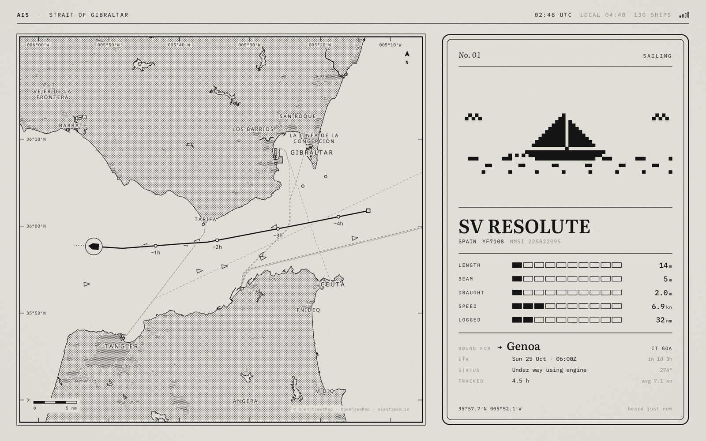

# AIS E-Ink

A macOS screensaver that looks like an e-ink reader tracking ships. Every 45 seconds it
"full-refreshes" to a random vessel from one of eleven busy waterways. The left side shows a
dithered chart with the ship's last 12 hours of track, and the right side shows a Top Trumps-style
card with its stats.

Inspired by [Paul Lagier](https://www.youtube.com/@PaulLagierEN)'s video
[*I Built the Perfect Device for My Girlfriend's Weird Hobby*](https://www.youtube.com/watch?v=lsG5w9Y8AuI),
an AIS ship tracker on an e-ink display.



```
aisstream.io ──► collector (Python, LaunchAgent) ──► http://127.0.0.1:47823 ──► AISSaver.saver (WKWebView)
                 keeps 12h of tracks in SQLite         JSON API + web UI
```

## Setup

1. Get a free API key at <https://aisstream.io> (sign in with GitHub).
2. Store it and start the collector. It runs at login and restarts itself if it dies:
   ```sh
   scripts/set-key.sh YOUR_KEY
   scripts/install-agent.sh
   ```
3. Build and install the screensaver:
   ```sh
   saver/build.sh --install
   ```
4. In **System Settings → Screen Saver**, choose **AIS E-Ink**.

Ship trails get richer as the collector runs. After an hour or two most ships will have a
proper track. Until then the screensaver shows a "Listening for ships" page.

## Live wallpaper

```sh
scripts/install-wallpaper.sh     # remove with scripts/uninstall-wallpaper.sh
```

A small background app (no Dock icon) puts the same view behind your desktop icons on every
display, changing ships every 3 minutes without the black flash. macOS has no public API for
third-party wallpapers in System Settings, so this is a window at desktop level. Extra URL options
can be set with `defaults write com.akshatkalra.AISWallpaper params "dwell=60&region=tokyo"`.

For a still wallpaper or lock screen instead, open <http://127.0.0.1:47823/poster.html?region=hongkong>.
It draws every track in one waterway from the last 12 hours as a chart. Screenshot it at your
display's size, then pick the image in **System Settings → Wallpaper**.

## Explore mode

Open <http://127.0.0.1:47823/> in a browser to use the same UI interactively (the screensaver itself
dismisses on any input).

| key | action |
|---|---|
| `→` / `n` | next ship |
| `←` / `p` | previous ship |
| `space` | pause on this ship (it keeps updating) |
| `/` or `⌘K` | search ships by name or MMSI |

Click any of the small triangles or circles to jump to that ship, and drag or scroll to move the
map. Add `?region=salish` (or `dover`, `tokyo`, `rotterdam`, …; see `collector/aissaver/regions.py`)
to stay in one waterway.

## Development

```sh
cd collector
uv run aissaver-collector --mock     # fake ships on real shipping lanes, no API key needed
uv run pytest
```

Open <http://127.0.0.1:47823/> in a browser. URL options:

| param | effect |
|---|---|
| `dwell=N` | seconds per ship (default 45) |
| `flash=0` | no black flash on refresh (white only) |
| `preview=1` | static mode used for the System Settings thumbnail |
| `region=ID` | only show ships in one region |
| `saver=1` | screensaver mode: no controls, big clock (set by the `.saver` bundle) |
| `clock=0` / `clock=1` | hide or show the big clock and date |
| `hours=12` / `hours=24` | clock format (the `.saver` passes your Mac's setting) |
| `wallpaper=1` | wallpaper mode: 3 min per ship, no black flash |
| `inset=t,r,b,l` | extra padding in px (the wallpaper app leaves room for the menu bar and Dock) |

`web/dev/gallery.html` shows every pixel-art ship.

## Files

- `collector/`: aisstream client, downsampling store, HTTP API (`aissaver/api.py`), and mock feed
- `web/`: the e-ink UI (MapLibre with a custom 1-bit style on OpenFreeMap tiles)
- `saver/`: the Swift `ScreenSaverView` bundle, built without Xcode
- `wallpaper/`: the live wallpaper app, also plain `swiftc`
- `scripts/`: LaunchAgent install/uninstall (collector and wallpaper) and API key helper

Data lives in `~/Library/Application Support/ais-screensaver/` and logs in
`~/Library/Logs/ais-screensaver/`.

## Uninstall

```sh
scripts/uninstall-agent.sh
scripts/uninstall-wallpaper.sh
rm -rf ~/Library/Screen\ Savers/AISSaver.saver ~/Library/Application\ Support/ais-screensaver
```
